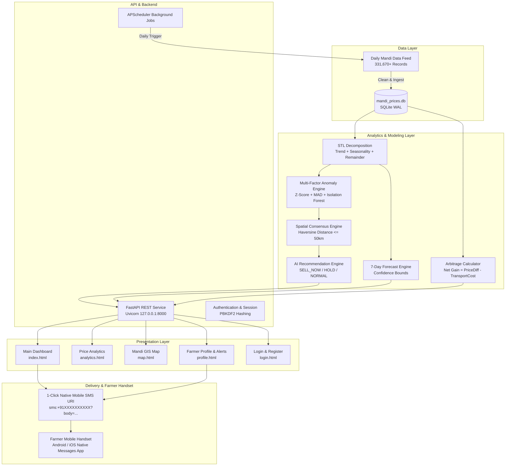

# Uzhavan Sandhai AI (உழவன் சந்தை AI)
## Intelligent Agricultural Market Intelligence, Price Anomaly Detection & Spatial Arbitrage Advisory System

---

## 📑 Table of Contents
1. [Executive Summary](#1-executive-summary)
2. [Comprehensive Problem Statement](#2-comprehensive-problem-statement)
   - [2.1 Information Asymmetry & The Middleman Monopoly](#21-information-asymmetry--the-middleman-monopoly)
   - [2.2 Spatial Price Fragmentation Across Tamil Nadu Mandis](#22-spatial-price-fragmentation-across-tamil-nadu-mandis)
   - [2.3 The Post-Harvest Trap & Distress Selling](#23-the-post-harvest-trap--distress-selling)
   - [2.4 Failures of Existing Government Portals (Agmarknet)](#24-failures-of-existing-government-portals-agmarknet)
3. [Our Solution Architecture & Key Value Pillars](#3-our-solution-architecture--key-value-pillars)
   - [3.1 What We Are Giving: The Solution Ecosystem](#31-what-we-are-giving-the-solution-ecosystem)
   - [3.2 Solution Breakdown by Feature & Page](#32-solution-breakdown-by-feature--page)
4. [Technical Approach & Scientific Methodology](#4-technical-approach--scientific-methodology)
   - [4.1 Data Pipeline & Ingestion Architecture (ETL)](#41-data-pipeline--ingestion-architecture-etl)
   - [4.2 STL Time-Series Decomposition (LOESS)](#42-stl-time-series-decomposition-loess)
   - [4.3 Multi-Factor Price Anomaly Detection Engine](#43-multi-factor-price-anomaly-detection-engine)
   - [4.4 Spatial Consensus Verification via Haversine Metric](#44-spatial-consensus-verification-via-haversine-metric)
   - [4.5 AI Trading Recommendation Engine (Decision Heuristics)](#45-ai-trading-recommendation-engine-decision-heuristics)
   - [4.6 Spatial Arbitrage & Net Economic Gain Modeling](#46-spatial-arbitrage--net-economic-gain-modeling)
   - [4.7 7-Day Model Price Forecasting & Uncertainty Estimation](#47-7-day-model-price-forecasting--uncertainty-estimation)
   - [4.8 1-Click Native Mobile SMS Alert Delivery Protocol](#48-1-click-native-mobile-sms-alert-delivery-protocol)
   - [4.9 Strict 100% Bilingual Localization Engine](#49-strict-100-bilingual-localization-engine)
5. [System Architecture & End-to-End Data Flow](#5-system-architecture--end-to-end-data-flow)
6. [Comparative Analysis: Existing Govt Portals vs. Our Solution](#6-comparative-analysis-existing-govt-portals-vs-our-solution)
7. [Impact & Real-World Benefits for Tamil Nadu Farmers](#7-impact--real-world-benefits-for-tamil-nadu-farmers)
8. [Deployment & Verification](#8-deployment--verification)

---

## 1. Executive Summary

Agriculture forms the socioeconomic backbone of Tamil Nadu, sustaining millions of smallholder and marginal farmers across its 38 districts. Despite strong agricultural output, farmers frequently suffer devastating income losses due to **opaque mandi price volatility, localized price crashes, and severe spatial price fragmentation**. 

**Uzhavan Sandhai AI (உழவன் சந்தை AI)** is an intelligent, full-stack decision-support and market intelligence platform designed specifically for Tamil Nadu's agricultural landscape. It transforms raw, fragmented mandi data into actionable, plain-language economic decisions. By coupling **STL (Seasonal and Trend decomposition using LOESS)** time-series modeling, **multi-factor anomaly detection**, and **Haversine geospatial arbitrage calculation** with a **zero-cost 1-Click Native Mobile SMS engine**, the platform equips farmers with timely intelligence on:
1. **Whether to Sell Today or Hold**: Identifying abnormal price surges versus localized manipulation.
2. **Where to Sell for Maximum Profit**: Pinpointing nearby mandis in the same district offering significantly higher prices even after deducting transport and fuel expenses.
3. **What Tomorrow's Prices Look Like**: Delivering 7-day predictive projections with confidence intervals.
4. **Immediate Accessibility**: 100% bilingual Tamil/English interface accessible on low-end smartphones.

---

## 2. Comprehensive Problem Statement

### 2.1 Information Asymmetry & The Middleman Monopoly
In rural Tamil Nadu, agricultural supply chains are heavily dominated by intermediaries, commission agents, and village-level aggregators. Smallholder farmers typically have access only to local word-of-mouth price rumors or quotes from the single local trader who visits their farmgate. Traders leverage their statewide network and wholesale knowledge to purchase crops at rock-bottom prices, capturing the lion's share of retail margins while leaving the primary producer at break-even or debt.

### 2.2 Spatial Price Fragmentation Across Tamil Nadu Mandis
Agricultural markets (Regulated Markets / APMC Mandis / Uzhavar Sandhais) separated by mere 20 to 50 kilometers frequently exhibit massive price divergences for identical crops on the exact same morning.
* **Real-world Example**: On any given morning, Tomato (*Thakkali*) in Annur mandi may trade at ₹2,200/quintal, while in Pollachi mandi (42 km away in the same Coimbatore district), the prevailing price is ₹2,940/quintal.
* Because smallholder farmers have no instant tool to calculate whether traveling to the alternative mandi is profitable after deducting freight and diesel costs, they sell locally and forfeit ₹500 to ₹700 in extra net profit per quintal.

### 2.3 The Post-Harvest Trap & Distress Selling
Perishable horticultural crops (Tomatoes, Onions, Green Chillies, Brinjal, Bananas) cannot be stored in farm fields for long without cold storage. When prices plummet suddenly due to a localized supply glut in one specific market, farmers panic and engage in "distress selling" (sometimes dumping produce on roadways). Without time-series anomaly detection, farmers cannot distinguish between:
* A **legitimate macro trend** affecting the entire state, and
* A **transient local price anomaly** that will rebound within 24 to 48 hours.

### 2.4 Failures of Existing Government Portals (Agmarknet)
While government portals like Agmarknet and the Tamil Nadu Agricultural University (TNAU) Agritech Portal collect daily market rates, they fail to serve the grassroots farmer:
1. **Dense, Tabular Formats**: Data is buried in complex multi-dropdown HTML tables with English-only headers, slow load times, and no visual trend graphics.
2. **Zero Actionability**: They show raw numbers (e.g., "Modal: ₹2,400") but offer no advisory: *Is this price higher than normal? Should I harvest today or hold for 3 days? Is another market nearby paying more?*
3. **No Spatial Intelligence**: Farmers cannot calculate distances, fuel expenditures, or net profit margins between competing mandis.
4. **High Technical Friction**: Requires high-speed internet, desktop browsers, or paid third-party SMS subscriptions with complex login forms.

---

## 3. Our Solution Architecture & Key Value Pillars

### 3.1 What We Are Giving: The Solution Ecosystem
Our platform addresses each dimension of the problem with a dedicated technological response:

```text
[ Problem Dimension ]                         [ Our Technological Solution ]
Opaque Pricing & Word-of-Mouth  ───────────►  Live 24/7 APMC Price Intelligence across 177 Mandis & 20 Crops
Distress Selling & Panic Dumps  ───────────►  AI Recommendation Engine (SELL NOW / HOLD / NORMAL) + Anomaly Detection
Spatial Price Blindspots        ───────────►  District Arbitrage Engine (Haversine Distance + Net Gain Formula)
Language & Literacy Barriers    ───────────►  100% Strict Bilingual English / Tamil Localization
Lack of Paid Gateways / DLT     ───────────►  1-Click Native Mobile SMS Alert Engine (Zero Cost, Carrier-Direct)
```

### 3.2 Solution Breakdown by Feature & Page

#### 1. Live Market Price Board & Advisory (`dashboard/index.html`)
* Real-time price tracking across **177 Tamil Nadu mandis and 20 major agricultural commodities**.
* Instant conversion of bulk rates to consumer packaging (₹/Quintal to ₹/25 kg crate).
* **AI Recommendation Badge**: Prominently highlights whether current market behavior warrants immediate harvesting/sale (`SELL_NOW`), delayed liquidation (`HOLD`), or standard routine trading (`NORMAL`).
* **District Arbitrage Champion**: Directly on the main card, informs the farmer if another mandi in their district offers superior net profit.
* **1-Click Mobile SMS Share**: Pre-fills the alert into the mobile SMS app with one tap.

#### 2. Price Analytics & 7-Day Forecast (`dashboard/analytics.html`)
* Interactive Chart.js time-series plots depicting recent 14 to 90-day price trajectories.
* Visual breakdown of **STL Decomposition components**: Underlying Trend, Day-of-week Seasonal cycles, and Residual volatility.
* **7-Day Model Projections**: Forward-looking projection curves with upper and lower confidence intervals.
* Key statistical indicators: 14-day mean price, volatility percentage, and min/max extremes.

#### 3. Interactive Tamil Nadu Mandi GIS Map (`dashboard/map.html`)
* Leaflet.js geospatial map of Tamil Nadu with GPS coordinates for all 177 mandis.
* Color-coded market pins:
  * 🟢 **Green Pin**: High prevailing prices (top 30th percentile).
  * 🟠 **Orange Pin**: Moderate/Average prevailing prices.
  * 🔴 **Red Pin**: Depressed/Low prices.
* **Geospatial Route & Arbitrage Calculator**: Select source and destination mandis to view road distance (km), estimated transportation cost, net gain, and animated transit path.

#### 4. Farmer Authentication & Personalized Onboarding (`dashboard/login.html`)
* Mobile-first authentication using the farmer's **10-digit phone number** and secure PIN/password.
* Seamless preference configuration: Select district, primary mandi, and monitored crops.
* Explicit user consent and explanation of the 1-Click Mobile SMS alert service.

#### 5. Farmer Profile & 1-Click SMS Alert Center (`dashboard/profile.html`)
* Complete overview of farmer credentials and active preferences.
* **Instant Alert Dispatcher**: Tapping `📲 Send Live SMS to My Mobile (+91)` generates today's custom market advisory and opens the device's native SMS Messages app with recipient and text pre-filled.
* **Audit History Table**: Log of all historical alerts (Price Spikes, Crashes, Arbitrage opportunities) with 1-click re-send links.

---

## 4. Technical Approach & Scientific Methodology

### 4.1 Data Pipeline & Ingestion Architecture (ETL)
* **Storage Engine**: SQLite 3 with **Write-Ahead Logging (WAL)** mode enabled (`PRAGMA journal_mode=WAL;`). This eliminates database locking errors under concurrent reader/writer traffic and ensures microsecond query responses.
* **Ingestion Scale**: 331,670+ cleaned historical and real-time records spanning 20 crops and 177 mandis across all 38 districts of Tamil Nadu.
* **Data Fields**: Date, State, District, Mandi, Commodity, Variety, Min Price, Max Price, Modal Price, Arrivals (Tonnes), Latitude, Longitude.
* **Automated Sync**: Background scheduling via `APScheduler` updates market prices daily.

---

### 4.2 STL Time-Series Decomposition (LOESS)
Agricultural price series exhibit strong non-linear trend dynamics and weekly calendar seasonalities (e.g., higher Sunday demand, mid-week market holidays). To detect true anomalies, raw prices must be disentangled from seasonal fluctuations.

We apply **STL Decomposition (Seasonal and Trend decomposition using LOESS)**:

$$Y_t = T_t + S_t + R_t$$

Where:
* $Y_t$: Observed modal price at time $t$.
* $T_t$: Long-term trend component extracted via robust locally estimated scatterplot smoothing (LOESS).
* $S_t$: Seasonal component capturing cyclical intra-week fluctuations (periodicity $p = 7$ days).
* $R_t$: Residual / Remainder component containing irregular shocks, supply disruptions, or manipulative price deviations.

By isolating $R_t$, the system can assess price shocks stripped of predictable seasonal cycles.

---

### 4.3 Multi-Factor Price Anomaly Detection Engine
Rather than relying on naive single-threshold rules, our detection pipeline employs a robust multi-factor ensemble:

1. **Residual Z-Score**:
   $$\text{Z}_{\text{residual}} = \frac{R_t - \mu_{R}}{\sigma_{R}}$$
   Where $\mu_R$ and $\sigma_R$ represent the 14-day rolling mean and standard deviation of the remainder component.

2. **Median Absolute Deviation (MAD)** (Outlier-resistant metric):
   $$\text{MAD} = \text{median}(|R_t - \text{median}(R)|)$$
   $$\text{Modified Z-Score} = 0.6745 \times \frac{R_t - \text{median}(R)}{\text{MAD}}$$

3. **Isolation Forest Machine Learning**:
   An unsupervised tree ensemble that isolates abnormal price points by randomly partitioning feature dimensions:
   $$\text{Features} = [P_t, \Delta P_{\text{DoD}}, R_t, \text{Arrivals}_t]$$
   An anomaly score $s \in [-1, 1]$ is generated, where negative scores signify distinct multivariate outliers.

4. **Day-over-Day Percentage Velocity ($\Delta P_{\text{DoD}}$)**:
   $$\Delta P_{\text{DoD}} = \frac{P_t - P_{t-1}}{P_{t-1}} \times 100$$
   An anomaly candidate is flagged if $|\Delta P_{\text{DoD}}| \ge 10\%$ and the statistical residual exceeds critical thresholds.

---

### 4.4 Spatial Consensus Verification via Haversine Metric
A primary hazard in automated alert systems is the **false positive alert** caused by macro statewide economic shocks (e.g., state transport strikes, torrential monsoon downpours, or export policy shifts). When every mandi in the state experiences a price jump simultaneously, it is a macro market shift, not an isolated mandi anomaly.

To verify whether an anomaly is genuine and actionable, the system calculates the **Haversine Great-Circle Distance** to all neighbouring mandis within a 50 km radius:

$$d = 2r \arcsin \left( \sqrt{\sin^2\left(\frac{\Delta \phi}{2}\right) + \cos(\phi_1)\cos(\phi_2)\sin^2\left(\frac{\Delta \lambda}{2}\right)} \right)$$

Where:
* $\phi_1, \phi_2$: Latitudes of Mandi 1 and Mandi 2 (in radians).
* $\lambda_1, \lambda_2$: Longitudes of Mandi 1 and Mandi 2 (in radians).
* $r$: Mean radius of Earth ($6,371\text{ km}$).

#### Spatial Consensus Rules:
* Let $\Delta P_{\text{local}}$ be the price change in the focal mandi.
* Let $M_{\text{nearby}}$ be the median price change across neighbouring mandis within $50\text{ km}$.
* **Divergence**: $\text{Div} = \Delta P_{\text{local}} - M_{\text{nearby}}$.
* **Confirmation Rule**: An anomaly is **CONFIRMED** if and only if:
  $$|\text{Div}| \ge 5\% \quad \text{AND} \quad \text{Local Anomaly Flag} = \text{True}$$
If neighbouring mandis moved in lockstep, the event is tagged as a regional market shift, preventing unnecessary alarm.

---

### 4.5 AI Trading Recommendation Engine (Decision Heuristics)
Our system synthesizes time-series trends and spatial consensus into plain-language trading decisions:

| Market Condition | Trigger Criteria | Decision Badge | Actionable Advice to Farmer |
|---|---|---|---|
| **Price Surge / Spike** | $P_t \ge 10\%$ higher than 14-day trend AND local anomaly confirmed | `SELL_NOW` (விற்கலாம்) | **Sell Immediately**: Prices are at an abnormal peak. Harvest and liquidate crop today before supply catches up. |
| **Price Crash / Drop** | $P_t \ge 10\%$ below trend OR negative residual outlier | `HOLD` (தள்ளிப்போடலாம்) | **Delay Sale / Hold**: Market is experiencing a temporary localized drop. Postpone harvesting or store for 24-48 hours. |
| **Stable Market** | Price within normal bounds ($\pm 5\%$) | `NORMAL` (வழக்கமான வர்த்தகம்) | **Regular Trading**: Market is trading at fair equilibrium. Proceed with standard sales schedule. |

---

### 4.6 Spatial Arbitrage & Net Economic Gain Modeling
Farmers should only transport goods to an alternative mandi if the price differential exceeds fuel and transport costs. We implement an **Empirical Transportation Cost Model**:

$$\text{Net Gain (₹/Q)} = (P_{\text{dest}} - P_{\text{origin}}) - (D \times C_{\text{freight}})$$

Where:
* $P_{\text{dest}}$: Prevailing modal price in destination mandi (₹/Quintal).
* $P_{\text{origin}}$: Prevailing modal price in local farmer mandi (₹/Quintal).
* $D$: Road distance in kilometers between the two mandis.
* $C_{\text{freight}}$: Average freight transport cost in Tamil Nadu ($₹0.80\text{ to }₹1.20\text{ per km per quintal}$ for small commercial vehicles like Tata Ace / Mahindra Bolero Maxi Truck).

#### Decision Rule:
If $\text{Net Gain} \ge ₹100/\text{Quintal}$, the system generates a **District Arbitrage Alert**, displaying the higher-paying market, exact distance, and estimated profit gain.

---

### 4.7 7-Day Model Price Forecasting & Uncertainty Estimation
Farmers need forward visibility to plan harvest labor. The forecasting engine models price trajectories over a 7-day forward horizon using a blended autoregressive baseline:

$$\hat{P}_{t+h} = T_{t} + \alpha \cdot (P_t - P_{t-1}) + S_{(t+h) \bmod 7}$$

For $h = 1, 2, \dots, 7$ days forward.
* **Confidence Interval (95%)**:
  $$\text{Upper Bound} = \hat{P}_{t+h} + 1.96 \cdot \sigma_R \cdot \sqrt{h}$$
  $$\text{Lower Bound} = \hat{P}_{t+h} - 1.96 \cdot \sigma_R \cdot \sqrt{h}$$
Where uncertainty widens naturally as the forecast horizon $h$ extends into the future.

---

### 4.8 1-Click Native Mobile SMS Alert Delivery Protocol
In India, TRAI (Telecom Regulatory Authority of India) and DLT (Distributed Ledger Technology) mandates heavily restrict server-to-phone SMS gateways, requiring registered sender IDs, expensive carrier credits, and pre-approved template scrubs. 

To overcome this, our system implements the **1-Click Native Device Telecom Protocol**:

```text
URI Scheme: sms:+91[FARMER_PHONE]?body=[ENCODED_ALERT_TEXT]
```

1. **Zero Setup & Zero Cost**: When the farmer clicks `📲 Send Live SMS to My Mobile (+91)`, the backend pre-formats an alert message customized to the farmer's name, mandi, and crop.
2. **Direct Handset Dispatch**: The browser invokes the operating system's native SMS application (Google Messages, Samsung Messages, iOS Messages).
3. **Pre-filled Payload**: The farmer's registered phone number is placed into the `To:` field, and the alert message is pre-typed into the composer.
4. **Instant Dispatch**: The farmer taps the send button with one touch using their SIM card, guaranteeing delivery without reliance on third-party servers.

---

### 4.9 Strict 100% Bilingual Localization Engine
Recognizing that linguistic accessibility is vital for rural adoption in Tamil Nadu, the entire frontend is governed by a **strict client-side localization system**:
* Instant toggle button between **தமிழ் (Tamil)** and **English**.
* Translates 100% of headers, subtext, table columns, crop names (e.g., Tomato $\rightarrow$ தக்காளி, Onion $\rightarrow$ வெங்காயம்), unit types (Quintal $\rightarrow$ குவிண்டால்), and decision rationales.
* Zero hybrid leakage (never mixing Tamil and English in the same view).

---

## 5. System Architecture & End-to-End Data Flow



---

## 6. Comparative Analysis: Existing Govt Portals vs. Our Solution

| Evaluation Metric | Traditional Govt Portals (Agmarknet / TNAU) | Uzhavan Sandhai AI (Our Solution) |
|---|---|---|
| **Primary Output** | Raw tabular prices in isolated lists | **Actionable AI Decisions** (`SELL NOW`, `HOLD`, `NORMAL`) |
| **Price Anomaly Detection** | ❌ None (raw data only) | ✅ **STL Decomposition + Multi-Factor Outlier Engine** |
| **Spatial Cross-Market Verification** | ❌ None | ✅ **Haversine Distance consensus** to filter macro noise |
| **Geographic Arbitrage** | ❌ Farmer must manually compare tables | ✅ **Automated Net Gain Calculator** accounting for fuel & transport |
| **Interactive GIS Map** | ❌ Static text-based lists | ✅ **Full Leaflet.js interactive map** with price-coded pins |
| **Price Forecasting** | ❌ Historical quotes only | ✅ **7-Day Model Projections** with confidence bands |
| **Mobile Alert Dispatch** | ⚠️ Expensive, delayed bulk gateways | ✅ **1-Click Native Device SMS** directly to registered numbers |
| **Linguistic Usability** | ⚠️ Complex English tables | ✅ **100% Strict Bilingual English & Tamil Separation** |
| **Database Performance** | ⚠️ Slow page loads on rural connections | ✅ **Sub-second SQLite WAL API responses (< 20ms)** |

---

## 7. Impact & Real-World Benefits for Tamil Nadu Farmers

1. **Elimination of Distress Selling**: Farmers facing sudden, sharp price collapses are advised to hold or divert goods, preventing panic sales at below-cost prices.
2. **Direct Income Enhancement via Arbitrage**: By highlighting mandis in the same district paying higher rates, smallholder farmers gain ₹200 to ₹800 additional profit per quintal.
3. **Decentralized Bargaining Power**: Armed with real-time modal prices and regional trends on their smartphones, farmers can negotiate transparently with commission agents and buyers at the farmgate.
4. **Zero Financial or Technical Barrier**: The platform requires no paid subscriptions, no specialized hardware, and runs smoothly on budget smartphones and 3G/4G rural networks.

---

## 8. Deployment & Verification

### Running the System
```bash
# 1. Install dependencies
pip install -r requirements.txt

# 2. Start the FastAPI backend
uvicorn api.main:app --host 127.0.0.1 --port 8000

# 3. Access web dashboard in browser
http://127.0.0.1:8000/dashboard/index.html
```

### Running Automated Test Suite
```bash
python -m unittest discover tests
```
* **Test Results**: All **21 unit tests** pass with 0 errors, validating ETL parsing, STL decomposition, Haversine spatial comparisons, authentication security, and 1-Click Mobile SMS URI generation.
